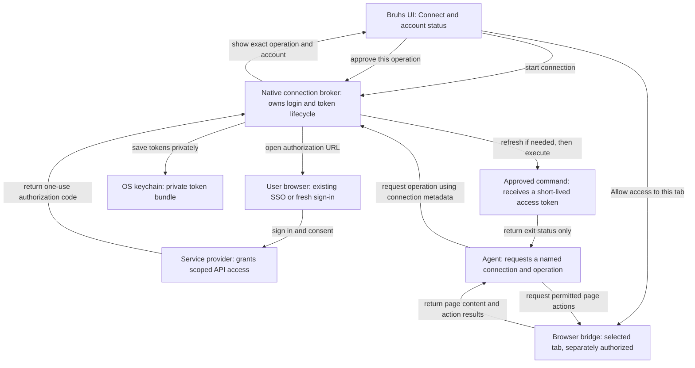

# Agent service connections

**Status:** Service connection implementation; live verification pending. Browser-tab phase planned. **Updated:** 2026-11-09.

The user selected all three initial providers: Google Workspace, Microsoft 365,
and GitHub. [Implementation and setup](service-connections.md) describes the
implemented code paths and verification limits. This design also records the separate
browser-tab phase, which is not part of OAuth sign-in and is not implemented yet.

Agents should connect to services through a single Connect action, reuse the
user's browser SSO session when available, and request sign-in only when needed.
API connections and access to a signed-in browser tab have separate permissions.
Saved passwords and API keys continue to use the existing private request flow.

## Problem

The current [credential broker](../bruhs-core/src/secrets.rs) accepts one secret
and injects it into one approved command. Its public
[request types](../bruhs-models/src/secrets.rs) contain no account, provider,
permissions, expiry, or connection state. Saving an access token as a static
secret would stop working when it expires and would give users no reconnect flow.

The [Google Calendar integration](../bruhs-core/src/google_calendar/mod.rs)
already implements browser authorization with Proof Key for Code Exchange (PKCE),
token refresh, and OS keychain storage. It is limited to one Google account and
calendar permissions. It is separate from the agent credential catalog, and
its refresh helper currently drops replacement refresh tokens. It is useful
evidence for the flow, not a generic service-connection implementation.

There is no app-owned connection to the user's browser tabs today. Ordinary
OAuth authorization can reuse a browser login without granting an agent control
of that browser. Website interaction needs its own connection and consent.

## Outcomes

- One Connect action works on web and desktop. Existing SSO is reused in the
  browser profile that holds it; fresh sign-in remains available.
- Users can see the connected account, granted permissions, connection status,
  and reconnect/disconnect actions.
- An account connection alone cannot execute a command or grant browser access.
- Cancellation, disconnection, and expired authorization stop new operations.
  Credential values never enter agent transcripts or connection listings.

Signing users into Bruhs, copying browser profiles, and granting access to every
tab are outside this feature. A service connection grants access only to APIs
and scopes that its provider supports; it is not a universal SSO credential.

## Design

### Flow: connect an account, then authorize its use

**Browser session reuse.** The web app opens authorization in its current browser
profile. Desktop opens the system browser; the user can select the profile that
contains their work session. Bruhs cannot promise that the system default is
the signed-in work profile. Do not force login or consent on every connection,
and do not collect SSO passwords. A provider can require account selection,
consent, MFA, or fresh authentication under its own policies.

Authorization uses a registered client, PKCE, and single-use state. Bind pending
state to the initiating UI request/turn, provider, redirect URI, requested scopes, and
intended reconnect target. A callback cannot approve an agent operation. Browser
authorization URLs and codes stay on the private UI channel. Arbitrary provider
endpoints and scopes supplied by a model are rejected. Local callback exceptions
must be exact routes; they do not weaken the server's other origin checks.
The web UI uses the existing local companion API; desktop calls the shared native
manager. This retains the [local API trust boundary](local-server-access.md),
not authentication against compromised local applications. A remote or cloud-only
web client is not supported by this flow.

**Connection identity and storage.** Keep typed account connections separate from
static secret values. Keychain token bundles have provider, issuer, client,
account identity, granted scopes, access-token expiry, and optional refresh-token
state. Only display metadata belongs in a catalog; tokens, authorization codes,
and PKCE verifiers do not. Identify an account by the provider's stable identity,
not its display email. Reconnection must not silently replace a different account
or expand permissions. Existing Calendar credentials are not silently imported
or granted to agent commands.

Represent Disconnected, Connecting, Connected, Needs sign-in, and Unavailable as
distinct states. Each attempt captures a connection generation. Canceling or
disconnecting advances that generation, so a late callback cannot save an account
or resume an operation. Project access is approved explicitly in the private
operation form, not inferred from account presence or a model-supplied path.

Refresh happens in the native broker, with serialization per connection so two
operations cannot race a rotating refresh token, including across server and
desktop processes. Once a refresh starts, finish its exchange and persist the
replacement even if the requesting operation is canceled; cancellation still
prevents command execution. Disconnect fences the result from persistence and
revokes any newly returned grant when supported. An expired or revoked grant moves to
Needs sign-in; network and keychain errors remain distinguishable and retryable.
Use provider expiry and polling instructions rather than inventing token lifetimes.

**Approved agent use.** Agents discover safe service/account metadata and request
an operation against an opaque connection reference. The broker validates the
reference against the turn's approved project access. The user reviews the exact
command, working directory, account, and credential variable. Refresh tokens
never reach commands; commands receive only the required access token. Preserve
the existing exit-status-only command boundary and cancellation behavior. An
approved command can transmit its credential, as documented for static secrets.

**Browser access.** Start with an explicit connection to a selected Chrome or Edge
tab through a browser bridge. The secure store records connection metadata;
cookies stay browser-managed. OAuth sign-in does not install, connect, or grant
this bridge. The grant belongs to a thread, tab, and origin, and ends on disconnect
or turn teardown. A navigation to another origin requires new authorization.
Authentication pages are handed to the user rather than operated by the agent.

Expose page navigation and interaction through the broker. Do not forward an
unrestricted browser tool catalog: cookie/storage export, raw network headers,
and arbitrary script execution could reveal credentials. Browser page content
does enter model context and can contain private information; this differs from
the exit-status-only credential command flow. The tab grant must make that clear.

**Disconnect.** Invalidate local operation references and pending callbacks, and
clear local credentials. Keep a durable generation fence even if deletion fails.
Do not revoke the provider grant automatically: Google revocation can invalidate
tokens across other clients in the same project, while Microsoft has no suitable
per-token public-client endpoint. Do not log the user out of their normal browser
SSO session. Already-running external operations
may have their own credential copy; disconnection cannot undo their effects.

## Alternatives and limits

Saving OAuth tokens as ordinary secrets would lose expiry, rotation, permissions,
and reconnect behavior. Opening a new isolated browser would discard the session
reuse the user requested. Giving an agent unrestricted access to the user's
browser would couple a routine service connection to all of their signed-in tabs.

Use the [native OAuth standard](https://www.rfc-editor.org/rfc/rfc8252.html) for
browser SSO reuse. An existing-browser bridge is supported by
[Playwright](https://playwright.dev/mcp/configuration/browser-extension), but the
integration must restrict its capabilities before offering it to agents. A
fresh browser profile is an optional sign-in path, not the default. Provider
policies can still [require reauthentication](https://learn.microsoft.com/en-us/entra/identity/conditional-access/concept-session-lifetime).

The browser phase needs a prototype before its implementation plan is approved:
demonstrate authenticated pairing, selected-tab enforcement, and an action
allowlist containing navigation, visible-page snapshots, click, type, and scroll.
Prove that other origins, tabs, and raw credential access are unavailable. Use
provider-specific authorization hosts to suspend agent access during sign-in;
do not assume every login page can be recognized from its DOM. If the existing
bridge cannot enforce these boundaries, evaluate a narrow app-owned extension.

## Rollout and verification

Deliver one service end to end before adding more providers. App registration,
redirect configuration, requested permissions, and tenant consent must be verified
for that service. Then integrate the separate browser-tab grant. Each surface
ships with account/status parity on web and desktop; no inactive Connect controls.

Use synthetic providers and an in-memory keychain to verify state replay,
wrong-provider callbacks, account mismatch, refresh-token rotation and concurrency,
cancel during login/refresh, disconnection before execution, and denied
cross-project access. Canary tokens must be absent from logs, events, listings,
errors, and provider transcripts. Verify browser grants across thread changes,
origin changes, tab closure, and bridge disconnect. Test live SSO session reuse
separately with the selected provider; mocked OAuth cannot prove it.

## Provider decision

All three providers are included with separate client registrations and read-only
initial permissions. Existing Calendar credentials and scopes are not imported.

Implementation slices

These are dependency-ordered review units, not opened pull requests. Target sizes
exclude generated files; split a slice further if implementation exceeds them.

| Slice | Depends on | Estimated reviewable lines |
|---|---|---|
| Typed connection identity and keychain lifecycle | Provider selection | 250-350 |
| First-provider login, callback, and reconnect | Connection lifecycle | 300-400 |
| Refresh rotation, cancellation, and disconnect | Provider login | 250-350 |
| Agent discovery and per-operation authorization | Token lifecycle | 300-400 |
| Connect and account status in web and desktop | Agent authorization | 300-400 |
| Browser bridge feasibility prototype | Account connection flow | Size after pairing/capability audit |

Plan the browser implementation slices after the prototype establishes the
pairing protocol and enforcement mechanism. The service connection does not
depend on browser automation.

