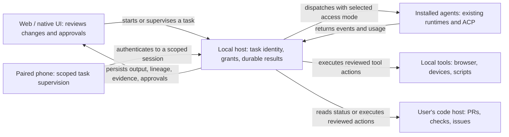

# Local agent workbench

**Status:** implemented; acceptance checks recorded below · **Updated:** 2026-11-13

Bruhs has agent chat, worktrees, previews, and cross-thread messages, but completing a coding task still requires separate tools for pull request review, browser verification, and remote supervision. Add those workflows around an explicit, persistent task session hosted on the user's machine. Managed cloud compute, hosted relays, and vendor-operated storage are excluded.

## Problem

The existing web app owns chat history in IndexedDB and starts queued turns while its chat page is mounted (`docs/thread-messages.md`). The desktop owns a separate local history. A second device cannot safely resume either history by opening another browser. Existing `pulls` integration reads GitHub references, while preview embeds a page without giving an agent controlled browser access. These ownership boundaries must remain explicit as new capabilities are added.

## Goals

- Review a local change, open a pull request, inspect checks/comments, address feedback, and merge through a reviewed operation.
- Run delegated tasks with persistent lineage, outputs, approvals, cancellation, editable specifications, and explicit verification.
- Reconnect to host-owned tasks from a paired browser or phone and supervise them over a private network or an SSH tunnel.
- Let an explicitly authorized agent inspect a dedicated browser or installed mobile device, and retain local verification evidence.
- Configure ACP agents, inspect measured usage and reported quotas, and recover work after a reported reset without inventing a quota.
- Reuse project setup/run/teardown commands, issue context, dictation, and attention notifications on both app surfaces.

**Non-goals:** managed cloud workspaces; hosted pairing relays; copying signed-in browser profiles; silently migrating client-owned chats; automatic publication, comments, merges, or provider usage without user action or a previously reviewed automation.

## Design



### Ownership and persistence

Host-owned task sessions are explicit alongside existing chats. Browser disconnect never cancels a host task. Server restart records an interrupted run; it does not claim that a dead provider process resumed. Existing chat can supply a reviewed handoff to a task, but remains authoritative for its own history. Parent/child links, fork source, and bring-back records persist with the task. A saved spec has a revision; verification identifies which revision it checked.

New stores are private files under the application data directory, use atomic replacement, and never hold bearer tokens in public snapshots. Existing databases and their migrations remain untouched. Any subsequent database migration must ship separately from its consumers.

### Authorization

The current loopback API and origin checks remain in force. Remote task supervision has a separate authenticated listener/router and explicitly scoped capabilities. Guests can see only their shared task; guest prompts wait for the owner. Tokens can be revoked. Remote access operates through a private network or SSH tunnel; no relay is provisioned.

Local browser sessions use a dedicated temporary profile. Browser/device grants are explicit and revocable. Agent-reported permission modes are never described as an OS sandbox. Operations that cannot honor the chosen access mode fail before execution. PR writes, process launches, and lifecycle commands show their target and arguments before execution.

### Boundaries and evidence

Typed domain modules are shared between both clients; core modules own native I/O and server routes adapt the same operations. No client receives provider credentials. Commands use argument vectors, explicit directories, bounded capture, and actionable errors. Quotas come from provider reports, never token estimates; an unknown window stays unknown. Pricing is user-configured and labelled an estimate. Timeouts and capture limits reuse existing contracts or state their resource budget next to the implementation.

## Alternatives

| Option | Decision |
| --- | --- |
| Make another browser read desktop files directly | Rejected: it would create conflicting writers and expose private life data. |
| Move all existing chats to a new server database immediately | Rejected: risks losing or duplicating independent web/native histories. |
| Managed cloud execution or hosted relay | Excluded by the user's instruction. |
| Prompt-only delegation and verification | Insufficient: run state, permissions, and completion must have host-owned receipts. |

## Risks and rollout

- **Existing changes:** preserve the current dirty tree; new domains use separate modules, and shared wiring is edited narrowly.
- **Remote access:** default remains loopback-only; enabling a paired task listener never exposes calendar, recordings, people, money, or arbitrary local APIs.
- **Cancellation:** stopping a parent stops active descendants and tool processes; state distinguishes failed, cancelled, interrupted, and completed.
- **External actions:** synthetic tests never create real PRs, comments, merges, or paid agent turns. Live operations require their normal product action.
- **Compatibility:** missing Chromium, adb, Xcode, ACP commands, or code-host CLIs produce setup instructions, not empty success.
- **Rollback:** disabling a tool grant blocks later operations; disabling remote access revokes its sessions without deleting local task history.

<details><summary>Implementation slices</summary>

Each review unit is a dependency-ordered slice, targeted below roughly 400 reviewable lines; domain groups contain multiple slices rather than one oversized PR.

| Group | Slices | Depends on |
| --- | --- | --- |
| Delivery | types and argv validation; reviewed PR actions; checks/reviews; watch journal; issue intake; lifecycle config; web UI; native UI | existing git and app state |
| Coordination | types and transition tests; private store; execution; approvals/cancellation; delegation; forks/fanout; specs/verification; paired access; guest queue; web UI; native UI | existing orchestrator |
| Local tools | grant types; CDP transport; browser commands; evidence; device discovery; device actions; dictation; web UI; native UI | existing capture and process infrastructure |
| Providers and usage | ACP configuration; protocol bridge; event mapping; usage journal; reported limits; reset recovery; settings and dashboard | existing agent event model |
| Integration | command navigation; panel wiring; server extensions; agent tools; end-to-end checks; documentation | domain slices |

</details>


## Use and setup

Open **Workbench** from the sidebar or command palette on web or desktop.
Tasks, Delivery, Verification, Hosts, Usage and Providers share the same local host.
Use **Continue in workbench** to copy an existing idle chat into a durable task.
Starting a task explicitly uses the selected installed runtime and access mode.

- [Task workspaces and paired phone/guest access](task-workspaces.md)
- [GitHub/GitLab delivery, Linear/Jira intake, stacks, scripts and watches](local-delivery.md)
- [Owned SSH connections](remote-hosts.md)
- [Native iOS/Android companion](native-mobile-app.md)
- [Browser/device verification and local dictation](local-verification.md)
- [Historical usage imports and ACP configuration](local-agent-usage.md)

Providers accepts a literal installed ACP command, arguments, model IDs and its
advertised native mode IDs. Modern ACP config options and legacy mode requests
are supported; custom selector IDs are explicit. The selected access mode is
applied after model changes and confirmed before the prompt. Select `acp/instance/model` in the existing model
picker or task form. An unavailable native mode fails before the prompt runs.
Usage records provider-reported completed Bruhs turns. Prices apply your current
configured API-equivalent rates, including separate cache reads/writes. Unknown
usage and unpriced totals stay unknown. Usage can preview and import local Claude
Code/Codex token metadata. Imported history remains separate from measured Bruhs
turns because their overlap cannot be proven. Estimates are not subscription bills.

Phone access uses the separately configured `BRUHS_TASK_BIND` task listener,
expiring owner/guest tokens, and your private network, SSH tunnel or HTTPS proxy.
Managed cloud workers, hosted relays and vendor-hosted task storage are excluded.

## Supported boundaries

GitHub and GitLab support reviewed delivery and branch stacks. Linear/Jira
issue intake uses privately configured credentials. Reviewed branch-stack merges
run bottom-up with SHA leases. GitHub native asynchronous stack merging uses a
separate owner-only acknowledgement of server-current heads, an operation UUID,
and durable pending/partial/unknown outcomes; agent tools cannot acknowledge it.
The delivery guide records the concurrency limits. Local stack rebase uses isolated replay and atomic leased
branch updates, and leaves remote pushing as an explicit separate action.

Device tools use installed Android Platform-Tools, Xcode simulators and optional
idb for touch/text. Continuous device video uses adb/ffmpeg or idb, bounded
frames and one displayed-frame acknowledgement at a time. Stop, disconnect and
revocation end capture; video is not saved. Screenshots remain durable evidence. Local dictation reuses the capture daemon and downloaded Whisper
models. Microphone permission, recognition accuracy and connected physical
hardware require a live device check; automated acceptance uses synthetic audio
and device transports.

## Original Workbench acceptance

The next implementation pass is documented in [Native companion and workflow completion](workbench-mobile-v2.md).

Validation uses temporary data stores, synthetic Git repositories and fake
GitHub/ACP commands. No real PR, comment, merge, paid model turn or managed cloud
worker was created.

- Shared model unit suite: 469 passed, one unrelated diagnostic test ignored.
- Workbench core suite: 50 passed, covering persistence, scopes, permissions,
  nested single-slot delegation, cancellation, quotas, delivery/stack failure paths
  and browser protection. The explicitly enabled live Chrome test also passed.
- Eight HTTP boundary tests passed for hostile origins, verification-browser
  HTTP/WebSocket identity, token revocation, isolated phone routes and delivery
  receipts.
- Native capture/dictation tests, silent-audio transcription, native/web/server
  compilation and the real WebAssembly target passed. Strict Clippy passed for
  core, models, server, web and desktop across all targets with warnings denied.
- Browser checks covered 375/640/1280px layouts, streaming draft/focus retention,
  malicious text rendering, reviewed action execution, stack receipts, PWA assets,
  provider forms, and guarded issue/dictation handoffs. A navigation race in issue
  prefill and an HTML pattern compatibility error were found and corrected.
- An actual local server and its installed MCP helper ran a synthetic ACP parent,
  started two Plan children in distinct worktrees, awaited both answers, and
  completed with durable parent/child records. The synthetic worktrees were then
  removed. This tests the complete provider → tool → host → child → result flow.

Reproduce targeted checks:

```sh
CARGO_INCREMENTAL=0 cargo test -p bruhs-models --lib
CARGO_INCREMENTAL=0 cargo test -p bruhs-core --lib -- coordination:: delivery:: local_tools:: workbench_tools:: agent_extensions:: agent::external::acp:: agent::external::process::process_tests::oversized
CARGO_INCREMENTAL=0 cargo test -p bruhs-core live_browser_fills_clicks_and_saves_screenshot_then_revokes --lib -- --ignored
CARGO_INCREMENTAL=0 cargo test -p bruhs-server --bin bruhs-server -- local_access:: routes::coordination::tests routes::delivery::tests
CARGO_INCREMENTAL=0 cargo test -p bruhs-desktop --bin bruhs-desktop -- dictation voice_capture
CARGO_INCREMENTAL=0 cargo test -p bruhs-capture --bin bruhs-capture routes::dictation
CARGO_INCREMENTAL=0 cargo check -p bruhs-desktop -p bruhs-server -p bruhs-web
CARGO_INCREMENTAL=0 cargo check -p bruhs-web --target wasm32-unknown-unknown
CARGO_INCREMENTAL=0 cargo clippy -p bruhs-core -p bruhs-models -p bruhs-server -p bruhs-web -p bruhs-desktop --all-targets --no-deps -- -D warnings
```

Incremental compilation was disabled for the final acceptance run after the
host disk filled. Only this repository's generated incremental cache was removed;
source files, local application stores and existing work were preserved.

Formatting and cleanup: the 76 Rust files in this implementation and its shared
integration points passed targeted rustfmt with module traversal disabled.
The workspace-wide `cargo fmt --all -- --check` still reports formatting in
other in-progress database, Pith, chat and credential changes; those areas were
not broadly reformatted. All owned preview tabs, temporary servers, Chrome
profiles and synthetic child worktrees were closed or removed after acceptance.
