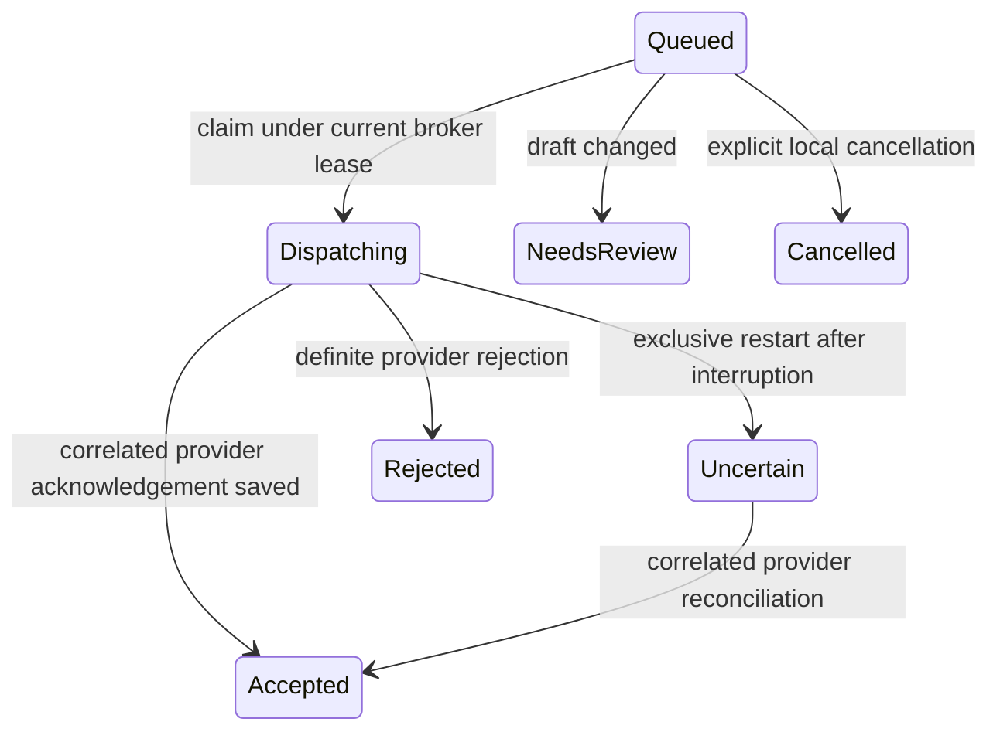

# Connected-mail runtime

The server explicitly opens one canonical cache with `MailRuntime::open` and
attaches it to `AppState`. Desktop construction opens no second mail cache and
starts no duplicate sync worker. `AppState::builder().build()` remains pure,
including outside Tokio. Existing imported conversations stay in their local
stores and are never associated with a mailbox by display name or email label.

The default database is `server/mail.sqlite3` in the app's local data directory;
`BRUHS_MAIL_DB` selects an explicit nonempty path for isolated hosts/tests.
New Unix directories/files use 0700/0600, and an exclusive ownership lock covers
all runtime clones and pending blocking writes. Existing symlink paths resolve
to the same owner; hard-linked database files are refused because SQLite journal
identity depends on the filename. The ownership file is separate from SQLite's
database locks, including on macOS.

SQLite runs on blocking workers behind one async writer lock. A cancelled
caller cannot release runtime ownership before its started write ends. Successful
writes publish a wake hint from that worker even if the caller disappears. A
hint is not a durable sync cursor: consumers reread saved records and revisions.
Sync records, confirmed deletions and the corresponding provider cursor commit
together. Failed writes retain the earlier cursor and data.

Mailbox identity hashes provider, OAuth registration and stable account subject.
It survives a token refresh or same-registration reconnect; authorization
generation remains a separate fence. Host-scoped client replica IDs prevent a
different server from overwriting a previous host's cache. No token or raw
account subject is stored in these identity records.

`MailRuntime::session` obtains current broker access and retains its connection
lease. Provider operations must keep that capability through the request and
receipt save. A caller-supplied matching identity never grants access. The broker
checks current generation, registration, tokens and mail scopes before creating
the capability; disconnect waits for an active lease. Read-only Calendar grants
do not create a mail session.

Drafts have independent client IDs and revisions. New-message drafts need no
provider thread; replies retain an explicit canonical/provider thread reference.
Revision conflicts preserve newer content. Confirmed remote thread deletion does
not erase an independent draft. A reviewed send captures immutable payload,
digest, host, authorization and draft revision. Replaying an operation ID cannot
change that content, and a second operation cannot duplicate the same pending or
accepted draft revision/payload.



Opening a second reader cannot recover another worker's dispatch. Only exclusive
runtime startup marks interrupted sends uncertain, and it never automatically
resends them. An acceptance receipt consumes only the exact reviewed draft
revision; a newer edit remains. **Acceptance is not delivery**: the stored receipt
keeps delivery unknown. Provider draft checkpoints store opaque IDs, not upload
URLs or tokens. Public error/debug output omits draft/message content.

The first integrated checkpoint passes 54 mail tests, 18 connection tests and
seven real disposable-server restart tests, plus strict Core/Server Clippy.
`target/inbox-ui-qa/mail-runtime-integration/checkpoint.json` records source
hashes and logs. The original prepared module/evidence files remain untouched.
This is storage and authorization groundwork; UI transport, provider adapters,
attachments, reconciliation after reauthorization, real account/sync/send and
recipient-delivery acceptance remain separate open work in the
[Inbox checklist](inbox-completion-2026-11-13.md).

The subsequent [Gmail read/sync slice](gmail-sync.md) adds full-thread/MIME
projection, resumable full/history reads and atomic full-scan reconciliation.
Its evidence is separate from the first storage checkpoint. The later
[connected Email integration](connected-mail-ui-2026-11-14.md) adds bounded browse,
real HTTP/native transport and web/native read/sync controls. Outlook, provider
writes, full UI/device acceptance and live acceptance remain open.

```sh
cargo test -p bruhs-core mail:: --locked --offline
cargo test -p bruhs-core connections:: --locked --offline
cargo test -p bruhs-core --test app_state_outside_runtime --locked --offline
cargo test -p bruhs-server --test meeting_restart --test transcript_restart --locked --offline
cargo clippy -p bruhs-core -p bruhs-server --tests --locked --offline -- -D warnings
```
