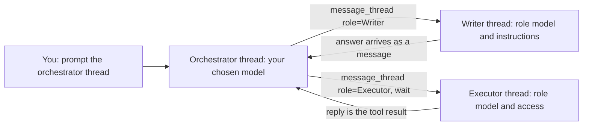

# Roles and models by task

One model does not have to do everything. A thread can orchestrate on one
model while other threads write or execute on others, and the jobs that are
not threads (meeting summaries, second opinions) each have their own model.

Both live in Settings → General, the same on web and desktop. The rules are
in `bruhs_models::roles`, so the two apps resolve them identically.

## Roles

A role is a named setup for a thread:

| Field | What it does |
| --- | --- |
| Name | How an agent asks for the role. Unique, up to 40 characters. |
| Use for | One line shown to agents, so they know what to hand the role. |
| Model | The model a thread with this role starts on. Empty keeps the sender's. |
| Effort | Claude effort for the thread's turns. Empty keeps your default. Codex ignores it. |
| Access | An access mode for the thread. It can only narrow yours. |
| Instructions | Added to every turn of the thread. Up to 4,000 characters. |

There are no built-in roles. Up to 12 can be defined.

### How a pipeline runs



An agent sees the roles in `list_threads`, which also names each thread's
model and role:

```
Roles a new thread can start with (message_thread's role, by name):
Writer · Claude Sonnet 4.6 · drafting prose
Executor · GPT-6.1 Sol · running and fixing tests
```

It starts a thread with one by passing `role` to `message_thread` (see
`docs/thread-messages.md`). The orchestrator is whichever thread you prompt;
it runs on the model you pick in the composer.

### Decisions

- **A role applies to a thread an agent starts.** `role` is refused together
  with `thread_id`: an existing thread keeps its own model and session. A name
  that matches no role is refused with the list of roles.
- **The role is resolved each turn.** The thread stores the role's id. Its
  model is set when the thread starts; its effort, access and instructions are
  read from the role on every turn, so an edit in Settings reaches the
  thread's next turn. A deleted role leaves the thread on its model with no
  role instructions.
- **Access only narrows.** A thread runs with the stricter of your current
  access mode and the role's. A role can make a reviewer plan-only; it can
  never give an agent more than you are in, or an agent could start a thread
  with a looser role to get around your mode. The loosest mode is therefore
  not offered for a role.
- **Instructions ride the thread's context.** They are added to Claude's
  system prompt and open a new Codex session, the way a meeting thread's
  transcript does. The server refuses instructions longer than a role can
  hold.
- **A project can override a role.** Model, effort, access and instructions
  can each be changed for one project; what is left alone keeps the role's
  value. Overrides are keyed by project name, like thread title instructions.

## Models by task

| Job | Setting | Default |
| --- | --- | --- |
| Meeting summaries | Meeting summary model (Claude models) | `claude-sonnet-4-5` |
| `/second-opinion` on a Codex thread | Second opinion by Claude | The default agent model |
| `/second-opinion` on a Claude thread | Second opinion by Codex | Your Codex configuration |

The choice travels with the request (`model` on the summarize request,
`reviewer_model` on the second-opinion request). A model the job's provider
cannot run is refused with a 400, never swapped for another. The summary
records the model that wrote it.

## Storage

- Web: `bruhs.roles` and `bruhs.taskModels` in local storage; a thread's role
  id is on its thread record.
- Desktop: `roles` and `task_models` in the state file, written only when
  there is something to save; a thread's role id is on its saved thread.

Stored values are cleaned on load: a model that is no longer offered, or that
the job's provider cannot run, is dropped so the default applies.

## Not built yet

- Assigning a role to your own thread by hand. Roles apply to threads agents
  start; your own threads pick their model in the composer.
- A role's name shown on its thread in the sidebar or header.
- Per-task model choices beyond the three above.

## Verification

```sh
cargo test -p bruhs-models roles
cargo test -p bruhs-models thread_link
cargo test -p bruhs-core second_opinion
cargo test -p bruhs-server
cargo test -p bruhs-web role
cargo test -p bruhs-desktop thread_link
```

`scripts/verify-thread-link.playwright.mjs` (live, spends tokens) sets up a
role in Settings and has an agent start a thread with it, then checks the new
thread's model, narrowed access and instructions.
