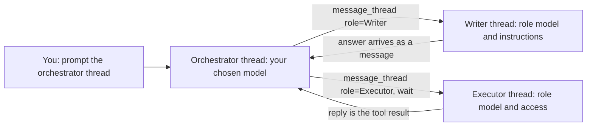

# Roles and models by task

One model does not have to do everything. A thread can orchestrate on one
model while other threads write or execute on others, and the jobs that are
not threads (meeting summaries, second opinions) each have their own model.

Both live in Settings → General, the same on web and desktop. The rules are
in `bruhs_models::roles`, so the two apps resolve them identically.

## Roles

A role is a named setup for a thread:

| Field | What it does |
| --- | --- |
| Name | How an agent asks for the role. Unique, up to 40 characters. |
| Use for | One line shown to agents, so they know what to hand the role. |
| Model | The model a thread with this role starts on. Empty keeps the sender's. |
| Effort | Claude effort for the thread's turns. Empty keeps your default. Codex ignores it. |
| Access | An access mode for the thread. It can only narrow yours. |
| Instructions | Added to every turn of the thread. Up to 4,000 characters. |

There are no built-in roles. Up to 12 can be defined.

### How a pipeline runs



An agent sees the roles in `list_threads`, which also names each thread's
model and role:

```
Roles a new thread can start with (message_thread's role, by name):
Writer · Claude Sonnet 4.6 · drafting prose
Executor · GPT-6.1 Sol · running and fixing tests
```

It starts a thread with one by passing `role` to `message_thread` (see
`docs/thread-messages.md`). The orchestrator is whichever thread you prompt;
it runs on the model you pick in the composer.

### Setting a role yourself

`/role` in the composer sets the role of the thread you are in:

| Typed | What happens |
| --- | --- |
| `/role` | Shows the thread's role, or the roles there are. |
| `/role Writer` | Gives the thread that role. The name matches in any case. |
| `/role none` | Removes the role. `off` and `clear` do the same. |

A role that names a model moves the thread to it, the way the model picker
does. Removing a role leaves the thread on the model it is on. The command is
never a turn, so it also works while one runs; that turn keeps what it started
with. When the role brings instructions (or takes some away), the thread's
next turn starts a new provider session; see Decisions.

A thread's role is named after its title in the chat header and on its
sidebar card. A role that was deleted shows nothing.

### Decisions

- **An agent can only give a role to a thread it starts.** `role` is refused
  together with `thread_id`: an existing thread keeps its own model and
  session. A name that matches no role is refused with the list of roles.
  Only you can change the role of a thread that exists, with `/role`.
- **The role is resolved each turn.** The thread stores the role's id. Its
  model is set when the role is given; its effort, access and instructions are
  read from the role on every turn, so an edit in Settings reaches the
  thread's next turn. A deleted role leaves the thread on its model with no
  role instructions.
- **Changed instructions start a new session.** A provider session keeps the
  instructions it started with: the Claude CLI ignores a new appended system
  prompt when it resumes a session, and Codex reads a thread's context only
  when a session opens. So a thread saves a stamp of the instructions its
  session started with (`roles::instructions_stamp`). When the role's
  instructions differ from it (a role set or removed with `/role`, or edited
  in Settings), the thread's next turn starts a new session and carries the
  conversation so far as context, the way a change of provider does. Effort,
  access and model are flags of each turn and need no new session.
- **Access only narrows.** A thread runs with the stricter of your current
  access mode and the role's. A role can make a reviewer plan-only; it can
  never give an agent more than you are in, or an agent could start a thread
  with a looser role to get around your mode. The loosest mode is therefore
  not offered for a role.
- **Instructions ride the thread's context.** They are added to Claude's
  system prompt and open a new Codex session, the way a meeting thread's
  transcript does. The server refuses instructions longer than a role can
  hold.
- **A project can override a role.** Model, effort, access and instructions
  can each be changed for one project; what is left alone keeps the role's
  value. Overrides are keyed by project name, like thread title instructions.

## Models by task

| Job | Setting | Default |
| --- | --- | --- |
| Meeting summaries | Meeting summary model (Claude models) | `claude-sonnet-4-5` |
| `/second-opinion` on a Codex thread | Second opinion by Claude | The default agent model |
| `/second-opinion` on a Claude thread | Second opinion by Codex | Your Codex configuration |

The choice travels with the request (`model` on the summarize request,
`reviewer_model` on the second-opinion request). A model the job's provider
cannot run is refused with a 400, never swapped for another. The summary
records the model that wrote it.

## Storage

- Web: `bruhs.roles` and `bruhs.taskModels` in local storage; a thread's role
  id and its session's instructions stamp are on its thread record.
- Desktop: `roles` and `task_models` in the state file, written only when
  there is something to save; a thread's role id and its session's
  instructions stamp are on its saved thread.

Stored values are cleaned on load: a model that is no longer offered, or that
the job's provider cannot run, is dropped so the default applies.

## Not built yet

- A menu for picking a role with the pointer. `/role` takes the name typed.
- Per-task model choices beyond the three above, and an effort for each.

## Verification

```sh
cargo test -p bruhs-models roles
cargo test -p bruhs-models thread_link
cargo test -p bruhs-core second_opinion
cargo test -p bruhs-server
cargo test -p bruhs-web role
cargo test -p bruhs-desktop thread_link
```

Two live checks spend real tokens and are not in the gate:

- `scripts/verify-thread-link.playwright.mjs` sets up a role in Settings and
  has an agent start a thread with it, then checks the new thread's model,
  narrowed access and instructions. It then sets the same role on another
  thread with `/role` and removes it again, checking each time that a new
  session starts and the reply follows (or stops following) the instructions.
- `BRUHS_DESKTOP_THREADS_SMOKE=1` (see `docs/thread-messages.md`) does the
  same on the desktop: a role an agent names, then `/role` by hand.
- `scripts/verify-task-models.mjs` asks a real server for a meeting summary
  and for a second opinion from each provider, each on a named model, and
  checks the provider CLI was called with that model. It also checks that a
  model of the wrong provider is refused.

  ```sh
  cargo build -p bruhs-server
  node scripts/verify-task-models.mjs "$PWD" --live
  ```
