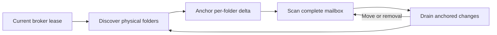

# Outlook Mail transport

Status: controlled read/sync/download verification and reviewed-send backend
checks passed. Compose HTTP/UI acceptance is in progress. This document does not
establish live-account, recipient-delivery, device or whole-product acceptance.

The server owns Outlook transport and the private canonical mail cache. An action
retains the current broker lease, checks the Outlook mailbox and authorization
generation, and commits content with its cursor under the existing revision CAS.
Tokens and continuation links never become browser capabilities.

Discover nested and hidden physical folders before anchoring their initial delta
positions. Then scan `/me/messages` and fetch complete conversations across folders.
Only the final account-wide scan page reconciles unseen cached conversations.
Subsequent rounds rediscover folder changes and consume the saved delta positions.
New/removed folders require a fresh complete scan; unchanged folders keep their
earlier positions so changes during scanning remain observable.

A folder tombstone can represent a move, not deletion of the conversation. Persist
its next/delta position together with a reconciliation-required phase, then scan
the whole mailbox. Never delete the entire conversation from a folder tombstone or
finish mailbox-wide reconciliation at a folder boundary. Failed pages retain the
previous transaction, saved rows and drafts. Expired sync state restarts discovery
and baselines while preserving saved mail until the new scan completes.

Only a successful empty conversation query confirms absence. A missing attachment
page fails the scan without committing its cursor or reconciling cached rows; a
retry can then recover surviving messages. Non-410 expiry responses carrying the
documented `syncStateNotFound` code also restart discovery without discarding saved
mail or drafts.

The transport uses immutable message IDs on every request, including continuation
and attachment requests. Continuations must keep the fixed Graph origin, current
mailbox collection/folder, no credentials and no fragment; opaque queries are
preserved. Redirects are disabled. The singleton client caps concurrency at Graph's
documented four requests per app/mailbox. The existing connected-mail 64 MiB
attachment/frame budget also bounds each response and accumulated thread/batch
payload. It fails explicitly rather than claiming a partial record is complete.

Message bodies are plain text or a plain-text projection of HTML. No remote image,
tracking pixel or attachment URL is loaded. Attachment metadata is requested even
for inline-only messages. Explicit file/item downloads use fixed Graph endpoints;
reference attachments remain metadata-only and their remote URL is never followed.
File destinations and opening remain explicit UI actions.

Email has separate Sync Gmail and Sync Outlook controls on web and desktop. Both
resolve the current connection before acting, retain app-owned sync/download jobs
across navigation, and fence stale host/account responses. Linked or unsupported
Outlook attachments have a disabled download action with an explanation.

File downloads must match their saved size. An attached Outlook message can have
a different exported MIME size; only that server response carries the bounded
`X-Bruhs-Mail-Export-Size` receipt. Browser and native clients reject malformed or
oversized receipts before creating a download. The native client retains its
explicit save dialog and atomic file replacement.

Outlook Mail requests and requires `User.Read` alongside `Mail.ReadWrite` and
`Mail.Send`. The current `/me?$select=id,mail` profile supplies the verified SMTP
sender; a sign-in name is never substituted for a missing mail address. Older
mail-only grants require renewed consent. Scopes do not participate in the
registration fingerprint, so renewal retains the same mailbox namespace and
saved drafts. Calendar permissions remain separate. See the delegated permission
requirements for [the current user](https://learn.microsoft.com/en-us/graph/api/user-get?view=graph-rest-1.0).

The Outlook reviewed-send adapter consumes the common one-attempt dispatch
capability after its durable claim and validates its host/account binding before
network access. It posts the exact frozen MIME bytes, encoded as standard base64,
to the fixed `/me/sendMail` endpoint. Redirects and automatic transport retries
are disabled. The raw MIME limit is 3,000,000 bytes, bounding the encoded body to
4,000,000 bytes before freezing or dispatch.

Only HTTP 202 records provider acceptance, with message/thread IDs left absent
when Graph supplies none. This receipt does not claim recipient delivery. Known
client rejections are distinct from uncertain outcomes such as a lost response,
timeout, redirect or server error. The durable worker survives caller drop and
does not replay an uncertain attempt. Provider response bodies are not exposed in
errors. Protocol sources: [MIME sendMail](https://learn.microsoft.com/en-us/graph/api/user-sendmail?view=graph-rest-1.0)
and [Graph request limits](https://learn.microsoft.com/en-us/graph/use-the-api).

Protocol sources: [folder discovery](https://learn.microsoft.com/en-us/graph/api/user-list-mailfolders?view=graph-rest-1.0),
[message delta](https://learn.microsoft.com/en-us/graph/api/message-delta?view=graph-rest-1.0),
[immutable IDs](https://learn.microsoft.com/en-us/graph/outlook-immutable-id),
[Outlook concurrency limits](https://learn.microsoft.com/en-us/graph/throttling-limits),
and [attachment downloads](https://learn.microsoft.com/en-us/graph/api/attachment-get?view=graph-rest-1.0).

The fresh default production capture is
`target/outlook-default-dist-capture-20261114T193910Z`, built with the default
feature set, API `http://127.0.0.1:3001` and `NO_COLOR=true`. Its 298 asset hashes,
nanosecond mtimes and file set were verified after copying; all 607 pinned inputs
were unchanged during the build. It includes the adopted immutable Fold-row
sharing modules. The combined web suite passed 440 tests (5 ignored), actual WASM
strict Clippy passed, and six native Inbox checks passed.

Against that exact capture, the full browser fixtures passed Gmail 1,532/0 and
Outlook 1,708/0 at 1280×800, 640×480 and touch 390×844. They cover current
authorization, stale replies, sync/Stop/resume across navigation, imported-history
retention, safe plaintext, real browser attachment files and recovery. The new
Outlook cases include item exports, invalid size receipts, and metadata-only
linked attachments. Deliberate invalid-header body cancellations are classified
only by their exact synthetic request identities; other API failures remain
unexpected. The original failed classification run is retained.

The only post-build input change was this test-harness classification; all
compiled web/model and asset inputs remained pinned. Separate warm-app slow-3G
passes passed Gmail 231/0 and Outlook 407/0. They applied browser network emulation
and explicit synthetic API response delays at 400 ms latency and 50 KiB/s download
throughput. Initial static/WASM loading was outside that pass. Three actual
read/sync/Stop/recovery recordings are retained. This is functional recovery
evidence, not startup, physical-network or performance acceptance.

The durable [validation summary](evidence/outlook-read-sync-2026-11-14.json) pins
the versioned reports. Build and per-suite evidence is under `target/outlook-qa/`;
the earlier common MIME/storage checkpoint records 135 Core mail tests, nine
production mail-router tests and strict Core/Server Clippy. All provider responses
in these tests are synthetic loopback fixtures. Real Outlook login, account sync,
outgoing dispatch and recipient delivery remain separate acceptance work.

Independent review found the subordinate-404 and non-410 expiry cases above. Both
regressions failed before repair and now pass in the 24-test Outlook suite,
including all four SMTP-profile sender checks. All-target/all-feature strict Core
Clippy also passed. The backend-only follow-up is pinned separately in
`target/outlook-qa/read-review-fixes-checkpoint.json`; the immutable browser capture
and its versioned acceptance reports are preserved.

The later combined backend checkpoint passed 165 Core mail, ten model and nine
existing mail-router tests, plus strict Core/Server lint. It includes both real
loopback HTTP send adapters and compiles the new compose route module; compose
route-specific cases and composer UI acceptance were still pending. The follow-up
profile-consent repair passed 20 connection tests, including four regressions
that failed before repair, the same 165 mail tests and strict all-target/all-feature
Core lint. All 388 Core/Models/SDK inputs remained pinned across those three green
runs. A renewed synthetic OAuth grant retained both the mailbox identity and an
actual SQLite draft. The separate [reviewed-send validation summary](evidence/outlook-reviewed-send-2026-11-14.json)
records those scopes without extending the historical browser capture's claim.
