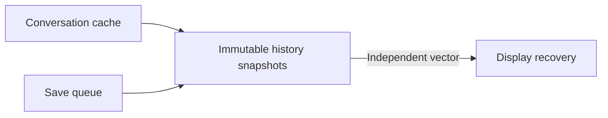

# Conversation save queue, 2026-11-13

Conversation edits now share immutable history snapshots, and an empty save queue finishes without requesting another frame. The pre-write rendering opportunity and post-yield batch selection remain. Prepared-history queue completion improves in all eight measured workloads; complete UI, provider and network actions remain unverified.

## Boundary and method

Timers cover actual `TaskSaves::edit_conversation` through either the IndexedDB transaction completion event or the worker clearing its saving flag after acknowledgement. The early completion listener is installed when the native transaction is created, before Rust registers its handler. A separate late listener verifies event order. Three intercepted Rust clock reads must reproduce both original enqueue/drain durations exactly; telemetry uses a separately bound clock.

The main app is unmounted in private Chrome 157.0.8103.52 contexts/origins on macOS arm64. Both release WASM builds derive from published main `8350d9b7`. Measurements use synthetic stores and block non-fixture requests. Load/recovery, caller draft construction, phase setup, readback, hashing, restoration and teardown are excluded. Case/format/version order alternates. No owned build or other benchmark overlaps retained intervals; unrelated host activity is present.

## Natural-entry results

Milliseconds, median (observed minimum–maximum), six retained samples per cell after one warmup. This is the writer-prepared variant; non-finite records retain structured fallback. The separate legacy variants and all five clocks are preserved in local raw evidence.

| History | Commit before | Commit candidate | Drain before | Drain candidate |
| --- | ---: | ---: | ---: | ---: |
| 100 messages | 1.50 (0.80–3.40) | 1.65 (1.00–6.10) | 17.90 (11.70–19.30) | 1.65 (1.00–6.10) |
| 460 messages / 41,000 parts | 143.95 (119.50–154.50) | 107.35 (106.70–120.00) | 153.85 (129.10–164.30) | 111.20 (110.60–123.70) |
| 45,000 messages | 135.75 (131.50–151.80) | 128.40 (122.50–133.40) | 144.45 (140.00–160.80) | 132.35 (126.40–137.50) |
| 75,000 messages | 243.65 (236.50–255.30) | 218.35 (207.40–238.90) | 258.80 (251.30–270.50) | 224.95 (214.00–245.30) |
| Large tool output | 28.70 (25.90–44.10) | 25.20 (24.20–26.10) | 42.70 (29.40–47.60) | 28.15 (27.10–29.10) |
| Long reasoning | 6.60 (6.30–6.80) | 6.35 (6.00–6.50) | 13.20 (7.00–17.90) | 6.80 (6.30–7.00) |
| Escaped output | 13.70 (13.50–15.10) | 12.95 (12.90–14.10) | 15.95 (15.10–17.30) | 14.05 (13.90–15.20) |
| Non-finite fallback | 9.00 (1.20–15.40) | 5.60 (2.80–9.20) | 24.20 (14.80–30.50) | 5.60 (2.80–9.20) |

Each successful single-edit candidate interval requests one scheduler frame; main requests two, including one after commit. Queue acknowledgement still takes measurable work. A zero timing is below clock resolution, not zero work. Six samples do not establish population tails or a general device guarantee.

## Balanced requested entry phases

The separate 396-interval follow-up retains 32 samples per history/format/version cell, eight at each requested phase (0, quarter, half, three-quarter of a calibrated frame period). Actual phase setup and calibration timestamps remain in the raw records. Setup is outside clocks. The table uses prepared records and reports median milliseconds.

| History | Commit before/candidate | After-yield write before/candidate | Drain before/candidate |
| --- | ---: | ---: | ---: |
| 100 messages | 8.35 / 8.75 | 0.70 / 0.75 | 24.30 / 8.75 |
| Long reasoning | 11.65 / 11.90 | 6.10 / 6.10 | 21.65 / 12.30 |
| Non-finite fallback | 6.35 / 12.20 | 1.10 / 1.10 | 22.30 / 12.20 |

Entry-to-commit still varies with the initial scheduler wait, including the unfavorable fallback commit median. The after-yield write interval starts at the first scheduler callback and remains similar in these short cases; total queue completion improves. Balanced requested phases do not guarantee identical delivered scheduling. These measurements explain separate stages and do not prove a full input-to-paint speedup.

## Correctness and remaining work

Cached originals and pending saves share immutable data; display recovery takes an independent mutable vector. Serialization/v12 schema, exact value comparison including NaN, original-checked writes, atomic groups, deletion and rollback guards are preserved. Full-history reads and rewrites remain.

All 620 comparison saves pass complete canonical/count/float/cache-original, exact-clock and frame-count checks. Forty untimed browser control intervals cover coalescing, edits during commit, stale originals, abort/retry and the phase wrapper. Three independent source reviews find no defect. The full 11-step merge gate passes 2,337 Rust tests (six existing ignored) and five Python asset tests. Nine checks on the generated ordinary release app pass, covering history/empty/return, expanded activity, rename and durable active deletion. Those ordinary-app checks establish correctness, not UI latency.

A 204-interval early/late-observer diagnostic uses the previous Arc-only candidate. A separate late-listener experiment and capture-flag preflight are retained as unsupported commit-boundary measurements. All raw inputs are kept under `target/performance-save-boundary*` and `target/performance-save2-*`; the JSON companion pins provenance. Ignored artifacts must be regenerated if absent.

The broader action log remains incomplete. Bounded history access, incremental writes, real input/paint, cold I/O, mobile, provider and impaired-network flows, and all seven matched T3 comparisons remain open.
