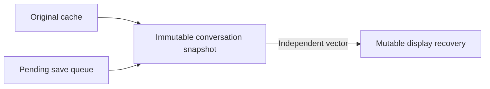

# Conversation save snapshots, 2026-11-13

The immutable-snapshot candidate is withheld from main. Large-history save medians improved, but a larger follow-up still shows slower completion for a small non-finite fallback workload. Native correctness, the full merge gate and ordinary browser checks pass. These results do not establish a complete action speedup or a faster-than-T3 result.

## Measured boundary

The primary clock starts immediately before `TaskSaves::edit_conversation` and ends after the production original-checked IndexedDB commit, queue acknowledgement and save-loop drain. It includes both existing scheduler yields. Loading, display recovery, caller draft construction, readback, hashing, restoration, owner setup and teardown are outside this clock. The enqueue clock ends at the synchronous method return.

The app is unmounted in private browser contexts on separate loopback origins. Both optimized WASM builds derive from main `8350d9b7` and use identical private adapters except accessor syntax. Chrome 157.0.8103.52 runs on macOS arm64. There are 224 intervals: 32 warmups and 192 retained, six per history/format/version cell. Case, format and version order alternate across blocks. User/system activity was present; no owned build or other benchmark overlaps these retained intervals.

## Save-queue completion

Milliseconds, median (observed minimum–maximum), six retained samples per cell. Writer-prepared histories use the production writer before measurement; non-finite data remains on structured fallback. The legacy column starts from untouched structured records.

| Synthetic history | Prepared before | Prepared after | Legacy before | Legacy after |
| --- | ---: | ---: | ---: | ---: |
| 100 messages | 8.20 (0.80–17.90) | 15.55 (2.00–32.80) | 18.45 (2.50–29.00) | 19.05 (1.60–35.80) |
| 460 messages / 41,000 parts | 140.00 (135.90–143.80) | 121.75 (115.50–135.10) | 216.30 (212.50–219.90) | 202.75 (197.90–211.20) |
| 45,000 messages | 155.60 (143.30–168.90) | 136.70 (125.30–148.90) | 247.90 (236.90–260.30) | 235.90 (227.30–251.70) |
| 75,000 messages | 269.40 (241.40–299.30) | 238.70 (228.60–246.50) | 410.55 (392.70–416.20) | 395.55 (383.20–408.90) |
| Large tool output | 44.00 (40.40–49.60) | 45.05 (32.20–52.20) | 48.45 (47.40–49.70) | 47.95 (44.10–48.90) |
| Long reasoning | 9.20 (7.10–17.30) | 11.45 (7.10–19.00) | 11.85 (10.90–33.90) | 11.50 (9.20–14.90) |
| Escaped output | 16.70 (15.40–20.70) | 16.00 (14.10–18.30) | 37.95 (25.20–45.40) | 25.45 (20.40–42.20) |
| Non-finite fallback | 13.55 (1.60–30.70) | 18.45 (10.30–28.10) | 17.10 (7.40–28.60) | 15.20 (1.90–32.50) |

Prepared 41,000-part, 45,000-message and 75,000-message median completion falls by 18.25, 18.90 and 30.70 ms. Their synchronous enqueue medians fall from 2.0, 2.3 and 3.9 ms; every retained candidate enqueue observation is between 0 and 0.1 ms. A zero clock reading is below timer resolution, not zero work. Smaller completion results overlap broad ranges and remain mixed; no general latency or population-tail claim follows from six samples.

## Focused small-case follow-up

An independently retained follow-up uses the same binaries and adapter, with 32 samples per history/format/version cell after one warmup (396 intervals, 384 retained). It starts after all owned builds and ordinary-app controls finish. Counterbalancing remains unchanged. This follow-up preserves the primary study rather than replacing its less favorable cells.

| Synthetic history | Prepared before | Prepared candidate | Legacy before | Legacy candidate |
| --- | ---: | ---: | ---: | ---: |
| small-control | 10.10 (7.10–27.40) | 10.60 (1.10–18.40) | 27.55 (10.00–29.90) | 11.40 (10.30–28.50) |
| long-reasoning | 13.40 (7.50–18.80) | 7.35 (6.80–18.40) | 10.45 (8.90–18.30) | 9.60 (8.80–11.00) |
| structured-fallback | 9.80 (1.70–26.80) | 26.30 (9.40–28.80) | 9.85 (1.30–18.20) | 12.45 (10.00–29.50) |

The prepared fallback median is 9.80 ms on main and 26.30 ms on the candidate. The other short-history directions vary across studies. The production scheduler yields before each attempt and again before noticing an empty queue; that is a source-identified investigation target, not proof that it caused the timing difference. Keep the snapshot design unmerged until this completion behavior is explained or improved.

## Correctness and scope

Cached originals and queued records share immutable message data. Display recovery still owns its mutable vector. Serialization, schema v12, finite/non-finite fallback, value equality (including NaN), exact-original conflict checks and atomic transaction guards retain their previous contracts. Full-history reads and rewrites remain.

Twenty functional controls pass across both versions, including coalescing, editing during an in-flight write, stale-original rejection, abort/retry and non-finite timestamps. All 620 primary and follow-up measured saves pass full canonical readback, ordered message/part counts, exact floating-point diagnostics and cached-original checks. Three independent source reviews report no defect. The full 11-step merge gate passes 2,337 Rust tests (six existing ignored) and five Python tests. Nine checks on the final ordinary release assets also pass, covering history/empty/return, expanded activity, rename and durable active deletion. All owned benchmark browsers close cleanly. Passing correctness checks does not override the mixed performance decision.

Ordinary `/api/agent` sends carry the new prompt, attachments and session options rather than the full stored history. That is source evidence, not a measured network win. Provider startup, streaming completion, cold I/O, real UI/input/paint, mobile and impaired remote transport remain outside this study. The seven T3 screenshot targets remain unmatched.

## Evidence

Raw runs, exact source/bundle hashes, the two-clock distributions, failed preflight, stale-cache rejection and private adapter sources are retained under `target/performance-snapshot1-*`. These ignored local artifacts must be regenerated if absent. The JSON companion keeps source and evidence provenance; ignored raw artifacts are needed to reproduce the runtime. The living all-action log remains incomplete.
