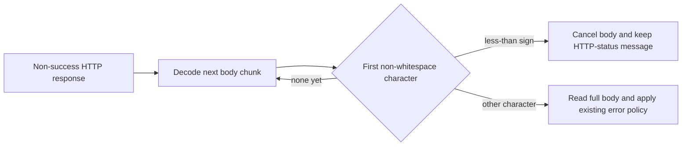

# Web HTTP error bodies

Web requests now stop reading an error response as soon as its decoded, trimmed content starts with `<`. The existing error policy already rejects that markup and displays the HTTP status. Previously, it waited for the entire rejected body. Plaintext and JSON still read through completion and retain their existing messages.

The tested three-file change is adopted in the shared worktree. It has **functional and response-body evidence**, with no controlled latency result, complete-action acceptance or matched T3 win. The later combined feature build has separate ownership and is outside this private capture.

## What changed

The HTTP helper delegates non-success bodies to a private streaming reader. Native `TextDecoder` preserves UTF-8 across chunks and flushes at EOF. The reader skips only initial Unicode whitespace, cancels recognized markup, and otherwise lets the unchanged `ApiError::http` policy validate the full body. A reader guard cancels unfinished reads and releases its lock when dropped.

Only `TextDecodeOptions` was added to the web manifest. Existing FormData features, dependency versions and Cargo.lock are unchanged. No body-size cap, new timeout or caller AbortController mutation was added. Success responses and the pure error-policy implementation remain byte-identical. [Exact patch and adoption](../target/performance-http-error1/adoption.json) · [Structural check](../target/performance-http-error1/structure-check.json).

## Matched body diagnostics

Actual default production WASM drove Email Refresh through real Chromium fetch and loopback HTTP. Each payload has one diagnostic per implementation. The server emitted a prefix, held the remaining bytes behind a gate, and then released it. Only API host/port forwarding changed. These gated runs establish body handling and cancellation, not bandwidth or a latency distribution.

| Payload | Before: received body B | After: received body B |
| --- | ---: | ---: |
| Immediate markup | 49 | 1 |
| BOM, Unicode whitespace, fragmented markup | 71 | 12 |
| Large markup | 1,048,631 | 27 |
| U+0085 then markup | 40 | 3 |
| Short plaintext | 45 | 45 |
| Short JSON error | 57 | 57 |
| JSON error with large ignored sibling | 1,048,642 | 1,048,642 |
| Split multibyte JSON error | 51 | 51 |
| Duplicate BOM | 46 | 46 |
| Invalid UTF-8 before `<` | 42 | 42 |
| Truncated UTF-8 at EOF | 29 | 29 |
| Empty body | 0 | 0 |
| JSON error string starting with `<` | 47 | 47 |
| Deliberately incomplete declared-length response | 49 | 49 |

Counts are fixture-server response writes, independently matched to Chromium CDP received-body bytes. They exclude headers, request bytes and TCP/TLS overhead. All fourteen final messages match their baseline. The incomplete response preserves its unreadable-body fallback rather than exposing a partial message. Zero for the empty body means an empty payload.

All four markup bodies close before gate release or teardown. The caller's AbortSignal stays un-aborted for this reader-owned cancellation. All fifteen candidate cases release the reader lock exactly once; the extra case uses the unchanged real 20-second mail deadline, verifies timeout feedback, closes the body and successfully retries. Its elapsed diagnostic is not normalized as a performance sample. [28 typed byte observations and five rejected tamper controls](../target/performance-http-error1/network-body-observations.json) · [Reader/deadline receipt](../target/performance-http-error1/reader-probe/completion.json).

## Validation and source scope

The private candidate passes 440 web tests with five ignored, strict host and actual-WASM Clippy, and a default production Trunk capture with 298 assets. The reader corpus passes 2,141 assertions. The preserved connected-mail regressions pass Gmail 1,595 and Outlook 1,771 assertions across 45 cases, including cancellation, Stop and Retry. Earlier baseline runs pass 1,917 and 1,980 assertions. Counts describe separate runs, not unique tests. [Build](../target/performance-http-error1/checks-build01.json) · [Mail regressions](../target/performance-http-error1/reader-probe/functional/result.json).

The baseline pins 607 inputs; the candidate pins 608. Of the existing inputs, 605 are unchanged, two change, and one module is added. Private package paths differ. Later shared-root sync-notice and QA wording changes are recorded separately; neither is folded into the historical private inputs. Root adoption copies only the three tested files under exact preimages and preserves those wording changes. All experiment-owned browsers, sockets and build processes are closed. The private build cache was removed while sources, bundles and evidence were retained.

The action-discovery repair separately recognizes ten new compose HTTP method/path identities. Captured source reproduces 376 entry points and 1,383 binding references from 481 files. This text scan is non-atomic and does not establish a semantic action denominator. Both historical/current snapshot replays pass; unknown, duplicate, missing and outer-router controls reject before output. [Discovery receipt](../target/performance-http-error1/discovery14-receipt.json).

## Remaining work

The paired timing protocol is prepared but sampling is deferred; no CPU/UI hold was granted. Preserve the existing 2,236 timing groups, 34 request-count cases and twelve earlier body observations. This phase adds 28 separately typed body observations. Complete semantic coverage, realistic concurrent/provider traffic, native/mobile error handling, physical paint and all seven equivalent T3 workloads remain open.

The native client also buffers non-success bodies before truncating logs. That is a source finding only; this change does not modify or validate that path.
