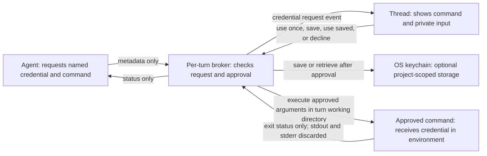

# Private credential requests

The agent needs credentials to complete work, but asking for them as chat text puts
them in provider context, saved transcripts, search, and tool output. Bruhs will
collect credentials in a separate inline form and use them in the harness.

## Flow: approve a command with a credential



## Decisions

- One `request_secret` MCP tool names the credential, reason, environment variable,
  and command argument array. The harness supplies the thread and working directory;
  model arguments cannot choose another turn. Approval always displays the operation.
- Each turn gets a separate authenticated loopback broker. The host binary also
  supplies its MCP stdio helper, so running the UI needs no separately installed
  bridge binary. Provider configuration contains a temporary broker capability,
  never a user's credential. Cancellation revokes the capability and pending input.
  Cancelling an individual MCP call or closing its stdin also withdraws its form.
  Plan mode does not offer the credential execution tool.
- Use once keeps the value in memory until the approved command starts. Save writes
  to the OS keychain under the canonical project path and credential name. Stored
  values always need another explicit approval to use; they are never sent to a UI
  read API or returned by a model tool. The form can forget a saved credential.
- Command stdin, stdout and stderr are detached from the provider. Only completion
  and exit status cross back. No value-bearing request body is logged or persisted.
  Keychain errors keep the request pending so the user can retry or choose use once.
- The pending form belongs to the originating thread and request. Changing threads,
  stopping, declining, and finishing clear private input; stale submissions cannot
  execute commands in a replacement turn.

## Manage saved credentials

Settings → Credentials on web and desktop lists saved names and project paths,
supports search, accepts a masked replacement value, and confirms deletion.
There is no endpoint or control for reading a stored value. Creating a saved
credential still starts from an approved thread request. Management never approves
an agent command; each subsequent use still needs the inline approval.

The app data directory's `credentials/catalog.json` holds only names, project
paths, hashed keychain IDs, and saved/recovery state. It is atomically replaced
with private file permissions; values remain separate OS keychain entries. A
cross-process lock serializes changes from the server and desktop. Listing reads
an atomic metadata snapshot without taking that lock or accessing keychain values,
so an outstanding OS unlock prompt cannot block the list.

Save, replace and delete first persist a `needs_attention` intent. Interrupted or
failed changes remain visible and can be retried by replacing or deleting the
entry. A damaged catalog is reported as an error rather than an empty list.
Deleting removes the stored copy; already-running commands may retain their own
copy until they finish. It does not revoke the credential at its external service.

The first implementation stored only hashed accounts, without enumerable names
or projects. Such entries are registered when a later thread request identifies
their project and name. The settings UI explains that older entries appear after
their next request; portable keyring APIs cannot reconstruct that missing metadata.

## Security boundary

This protects the normal harness data path, not against a compromised local app,
machine, browser origin, or intentionally malicious approved command. A command
given a credential can write or transmit it, including transformed versions.
Approval must show exact argv and cwd; this is not a sandbox or a general secret
retrieval API. Credential values may exist transiently in UI/network/process memory.
Stopping a turn kills the child; on Unix, the harness also kills descendants that
remain in its process group. Deliberately detached processes are outside that
guarantee. Invisible formatting controls in operation metadata are rejected, and
controls in host-supplied folder names are escaped in the review.

Codex's [MCP configuration](https://learn.chatgpt.com/docs/config-file/config-reference)
supports a tool timeout override (the CLI default is 60 seconds). Credential input
uses a one-day interaction ceiling so an overnight pause can resume. Turn or tool
cancellation revokes access sooner. The deadline is a harness interaction policy,
not a guarantee that a provider process remains alive for a day.

The injected Codex server is required at startup so its tool is present in the
initial catalog. Only `bruhs_secrets.request_secret` gets the CLI's per-tool
`approval_mode = "approve"` override: opening the form can proceed under the
non-interactive CLI policy, while executing its command still requires approval
inside Bruhs. Other MCP tools and the turn's shell sandbox retain their policies.
See the [Codex MCP settings](https://learn.chatgpt.com/docs/extend/mcp).

The existing local-server origin protections still apply. No remote deployment or
cross-device credential sync is introduced. Saved entries are separate from Google
Calendar tokens and ordinary thread storage; no database migration is needed.

## Alternatives

Masking a chat input still sends its value to the model. Injecting a credential into
the provider process lets its shell tools print it. Redacting exact output strings
misses transformations. A separate credential-use operation with output suppressed
keeps that boundary explicit, at the cost of returning no command output to the AI.

## Testing

Exercise request, decline, saved reuse/deletion, storage failure/retry, duplicate
submission, wrong-thread submission, disconnect and turn teardown. Synthetic values
must never occur in model-facing frames or event/transcript serialization. Test with
in-memory credentials in the normal suite; those tests never access a user's keychain.

The opt-in macOS live harness uses authenticated local CLIs and creates random
canaries under unique test-only keychain accounts. It isolates app data, the
working directory and browser storage, checks provider transcripts for the
canaries, and deletes its own saved entries in cleanup. It does not read existing
saved credentials. Run it separately from the normal test suite:

```sh
cargo build -p bruhs-server
(cd bruhs-web && BRUHS_API_URL=http://127.0.0.1:43013 trunk build --dist /tmp/bruhs-credentials-live-dist)
BRUHS_PLAYWRIGHT_PATH=/path/to/installed/playwright \
BRUHS_LIVE_CODEX_MODEL=your-supported-codex-model \
node scripts/verify-credentials-live.playwright.mjs "$PWD" /tmp/bruhs-credentials-live-dist --live
```

`--claude-only` and `--codex-only` select one provider. `--privacy-only` checks a
single use-once operation that tries to print its canary to both output streams;
neither output may reach the model or app storage. Reports and masked screenshots
go into a private temporary directory printed when the run finishes.
