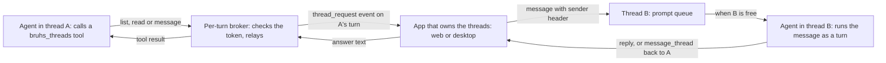

# Messages between threads

Each chat thread runs its own agent with its own context. An agent can see
the other threads, read one, and send one a message, so work can be split
across threads and the results can come back without the user copying text
between them.

## Flow: one thread asks another



## The tools

A turn gets a private MCP server, `bruhs_threads` (the host executable in
`--thread-mcp` mode):

| Tool | What it does |
| --- | --- |
| `list_threads` | Names up to 30 threads, most recent first: short id, title, project, and whether each is running or has prompts queued. |
| `read_thread` | Returns the last messages of one thread (6 by default, 20 at most), each clipped, inside a fixed size budget. |
| `message_thread` | Sends a message to a thread. Without `thread_id` it starts a new thread where the sender runs: same project, worktree and model. On desktop, `wait: true` holds the call until that thread has replied and returns its reply. |

Thread ids are accepted whole or as a unique prefix. Replies print the
shortest prefix that is unique.

Which tools a turn gets:

| Turn | Tools |
| --- | --- |
| Messages between threads is Off | None |
| Messages between threads is Read only | `list_threads`, `read_thread` |
| Plan mode | `list_threads`, `read_thread` |
| Codex in ask-first mode (it cannot ask) | `list_threads`, `read_thread` |
| Anything else | All three |

## Settings

Settings → General has two rows, the same on web and desktop:

- **Messages between threads**: Read and message (default), Read only, or
  Off. The web sends the choice with each turn (`thread_access` on
  `POST /api/agent`); the desktop puts it on the turn it builds.
- **Agent message limit**: 2, 4, 6 (default) or 10 messages in a row.

The web stores them as `bruhs.threadAccess` and `bruhs.threadHops`. The
desktop state file gets `thread_access` and `thread_hops`, written only when
they differ from the defaults.

## Decisions

- **The app answers, not the server.** The web keeps threads in IndexedDB and
  the desktop in its own files, so the core process cannot list or read them.
  The broker streams a `thread_request` event on the calling turn and waits up
  to 60 seconds for the app's answer (`POST /api/agent/thread-reply` on the
  web, `ThreadLinks::resolve` on desktop). The rules and the reply text are in
  `bruhs_models::thread_link`, so both apps answer identically.
- **A message is a queued prompt.** It joins the recipient's existing prompt
  queue and runs as an ordinary turn there, with that thread's own session,
  permission mode, approvals and history. The user can edit or remove it while
  it waits, and a held queue stays held.
- **Sending does not wait unless asked.** `message_thread` returns as soon as
  the message is handed over. An answer is a second message, sent by the
  recipient's agent with the same tool, that arrives as a new turn in the
  sender.
- **Waiting is a desktop feature.** With `wait: true` the call is held, for up
  to an hour, until the recipient's turn for that message ends; the tool
  result is that turn's reply, or why there is none (stopped, failed, removed
  from the queue, thread deleted). The delivered header tells the recipient
  its reply is returned and not to message back. The desktop refuses to wait
  on a thread that is itself waiting on another, which is what a deadlock
  would need, and does not wait on a thread whose queue is paused. The web
  runs one turn at a time, so the recipient could never answer while the
  sender's call is held: the server does not offer `wait` there
  (`AppStateBuilder::thread_waits`), and a request that asks anyway is
  delivered without waiting.
- **Chains stop at the user's limit.** A delivered message opens with a header
  line that names the sender and a hop count
  (`[Message from thread "Title" (id 1a2b3c4d), hop 2/6. …]`). The count is
  read back from the prompt of the turn that sends the next message; one past
  the limit is refused and the agent is told to hand back to the user. A
  prompt the user types counts from zero again.
- **Reads are free, writes follow the permission mode.** `list_threads` and
  `read_thread` never ask, and are marked read-only so a Plan turn may call
  them. On Claude, `message_thread` goes through the turn's permission mode
  like any other tool: Ask and Accept edits show an approval, bypass does not.
- **One capability per turn.** The broker listens on a loopback port with a
  random token that is revoked when the turn ends. The helper can only relay
  the three operations; it cannot answer one.
- **The header is for the model, not the reader.** Both apps show an
  agent-sent message as its body under a caption, `From thread “Title”`
  (blueberry, the information color), with ` · waiting for this reply` when
  the sender waits. Copy and Edit from here keep the whole prompt, and
  `read_thread` shows it whole to other agents.

## Web and desktop differ in one way

The desktop runs threads side by side, so a message to a free thread starts
its turn at once, the view stays where it is, and a sender may wait.

The web runs one turn at a time. A message waits in the recipient's queue
until the sender's turn ends; the view then follows the message to the
recipient, whose queue drains as usual. It does not follow when the user has
moved to another thread, has a draft in the composer, or the sender has its
own prompts queued. The message then stays queued in the recipient until that
thread is opened, and a notice says so. Waiting on the web needs the web to
run two turns at once, which it does not do yet.

## Verification

```sh
cargo test -p bruhs-models thread_link
cargo test -p bruhs-core thread_link
cargo test -p bruhs-server --test thread_mcp
cargo test -p bruhs-web thread_link
cargo test -p bruhs-desktop thread_link
```

Two live checks spend real tokens and are not in the gate:

```sh
# Web: both settings, a round trip between two threads, a read, a new thread.
cargo build -p bruhs-server
(cd bruhs-web && BRUHS_API_URL=http://127.0.0.1:43021 trunk build --dist /tmp/bruhs-thread-link-dist)
BRUHS_PLAYWRIGHT_PATH=/path/to/playwright \
  node scripts/verify-thread-link.playwright.mjs "$PWD" /tmp/bruhs-thread-link-dist --live

# Desktop (debug build): one thread starts another and gets a message back,
# then starts a third and waits for its reply inside the call.
BRUHS_DESKTOP_THREADS_SMOKE=1 BRUHS_DESKTOP_STATE_FILE=/tmp/bruhs-threads-smoke.json \
  cargo run -p bruhs-desktop
```
