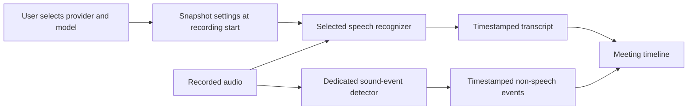

# Transcription improvement goal

Recorded 2026-11-09. This is a standing product goal for meeting capture on web
and desktop: keep improving transcription accuracy, responsiveness, speaker
attribution, and recognition of audible non-speech events. Users must be able to
choose the transcription model and provider that fit their privacy, hardware,
language, latency, and cost needs.

## Baseline

The capture daemon runs on-device Whisper through `whisper-rs`, with Metal on
macOS. Users can already choose Tiny English, Base English, Small English, or
Large v3 Turbo independently for live previews and the final transcript. Base
English is the default. Live inference checks for new audio every five seconds;
its volume gate is not a trained voice-activity detector. A final pass runs after
recording stops, followed by speaker attribution.

There is no dedicated sound-event classifier. Transcript confidence is currently
a placeholder, not a measured probability. No meeting-audio evaluation currently
justifies calling this state of the art.

The first provider-selection implementation adds a configured OpenAI-compatible
server for the final pass, with a user-entered timestamp-capable model ID. Live
previews stay on-device. See [provider setup and capability limits](transcription-providers.md).

## Improvement loop

Maintain a consented or synthetic evaluation set with reference words, speaker
turns, and sound-event timestamps. Include accents, names and technical terms,
multiple languages, overlap, noise, long silence, and mic/system audio. Never
upload users' recordings to build the evaluation set without their consent.

Evaluate candidate models and providers against the same recordings before
changing defaults. Record word error rate, speaker attribution error, false
transcripts during silence, time to first text, finalization time, CPU/GPU use,
memory, and provider cost. Measure on supported hardware and report accuracy
and latency together. Set numerical release thresholds from the first measured
baseline; do not invent scores or equate model size with quality.

Revisit candidates when a model/provider release or a reported failure suggests
an improvement. Keep the existing default until the evidence supports changing
it. This goal does not create a scheduled task or authorize paid evaluations.

## Delivery order

1. **Provider and model choice.** Preserve existing model preferences. Expose
   provider choice and the matching model settings on both web and desktop.
   Keep on-device processing as the default. Explain when audio leaves the
   device and apply changes to the next recording. Validate configuration before
   opening recording devices; never silently switch providers on failure.
2. **Measured speech quality.** Establish the evaluation baseline, evaluate
   alternatives, improve voice-activity detection and silence handling, and
   replace placeholder confidence with supported estimates or an explicit
   unknown state. Keep timestamp alignment and speaker attribution intact.
3. **Non-speech events.** Add a dedicated detector for audible yawns, burps,
   laughter, coughs, sighs, and related events. Check each candidate's actual
   label coverage; broad audio classification does not guarantee yawn support.
   Store event type, timestamps, model provenance, and confidence separately
   from spoken words. Measure precision/recall per event, tune false positives,
   and represent uncertainty. An audible event must not become an unsupported
   claim about a person's mood, health, or engagement.
4. **Ongoing parity and regression checks.** Keep web and desktop controls,
   persistence, manual recording, auto-recording, and recovery consistent.
   Add regression cases for reported failures and publish the evidence for
   quality improvements.

## Provider boundary

Keep credentials on the native side, out of browser storage, capture request
bodies, model context, and logs. Bind credentials to their configured service;
redirects or arbitrary model responses must not move audio or credentials to
another host. Preserve original recordings when a provider fails and report an
actionable error. New adapters must preserve the timeline contract or clearly
declare their capability limits before users start recording.
