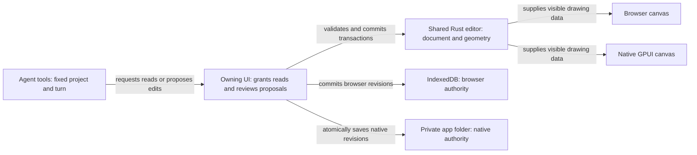

# Rust whiteboard v1

BNLE-66 will add a project whiteboard with one Rust document/editor model, a browser canvas renderer and a native GPUI renderer. It must support the ticket's drawing and local persistence flows, then demonstrate a frame-time win against a pinned tldraw build on an identical 1,000-shape scene. The performance result remains unproven until the renderers run the benchmark.

## Decisions

Revision-checked transactions will own document changes. Every edit supplies a base revision; validation completes before mutation, and inverse operations form undo entries. A drag stays in transient editor state until pointer-up and becomes one transaction. Pan, zoom, selection and text-edit focus stay outside the durable document. This avoids copying or saving the entire scene on every pointer move.

A CRDT is deferred because v1 has a local authoritative UI and reviewed agent proposals. Concurrent tabs/windows must detect storage conflicts, retain unsaved work and request review. An operation journal and stable IDs leave room for later collaboration without claiming it now.

The production editor will contain no tldraw or Excalidraw runtime. `tldraw@5.6.0` belongs only to the isolated benchmark comparator. Imports will convert their file records into the Rust model and report unsupported content explicitly.

| Layer | Responsibility |
| --- | --- |
| `bruhs-models::whiteboard` | Versioned documents; shapes/assets/typed links/source fingerprints; geometry, hit testing, bound arrows, selection transforms, snapping, layout actions, transactional edits, undo/redo, import/export and portable Mermaid conversion. No I/O. |
| Web whiteboard modules | Canvas painting, DOM controls/text editing, pointer/keyboard input, local IndexedDB catalog/documents/assets and revision-checked saves. |
| Native whiteboard modules | GPUI painting/input, local app-data catalog/documents/assets and atomic saves guarded against stale revisions. |
| Agent bridge | Project/thread/turn-bound list/read/propose/status tools. The app that owns local boards answers reads and retains immutable proposals. There is no tool that accepts its own proposal. |

## Document and interaction

The document records its UUID, project folder identity, title, format version, revision, shapes, asset references, sources and timestamps. A shape has an ID, geometry, z-order, style/text, optional group/frame parent and typed links. Arrow endpoints can bind to normalized anchors on another shape. Shared geometry resolves bindings after a target moves or resizes.

Rectangles/ellipses, arrows, text, notes, frames, freehand and local raster images are in scope. Shared editor actions cover selection, grouping, alignment/distribution, snapping, duplicate/copy/paste and undo/redo. File links retain line ranges; thread links select the existing thread. Other work links retain their typed target and open the corresponding in-place view where available. A local board catalog reopens boards from their original project. Browser/native stores are separate; portable export/import moves a board between them. Folder renames require explicit relinking, retain the board UUID and relative file links, and reset agent access until the owner grants it again.

Keyboard actions create shapes and frames, edit text, connect the next node, move selection/focus and expose actions through the command palette. Pointer capture groups a gesture; cancel reverts its transient preview. Toolbar and text editing must not lose unsaved state when switching the board's presentation or project.

The web renderer will cache static drawing and text work. Panning should translate cached content where possible, and dragging should redraw or transform the affected selection/bound arrows without rebuilding the entire document. Native painting will cache shape/text preparation and draw visible primitives rather than creating thousands of view entities. Culling and caches must remain enabled in both product and benchmark.

## Storage and privacy

Boards have their own catalog, not Knowledge-document snapshots. Web IndexedDB is authoritative for browser boards; native documents live beside the selected desktop profile in a dedicated private folder. Catalog entries are lightweight and boards/assets load on demand. A save always uses the document's stored scope, not whichever project became active while I/O was in flight. Request success is not commit success; browser transaction completion and native atomic replacement precede a saved acknowledgement. IndexedDB compares the revision in one write transaction. A native editor holds an exclusive per-board file lease; revision checks happen under that lease, so another Bruhs window cannot race the write. External noncooperating file edits are detected where possible, rather than treated as distributed transactions. A conflict retains local work and offers saving a separate copy under a new UUID; v1 does not silently merge it.

Imported and clipboard content is validated before applying. Existing attachment limits provide the file/image byte budgets. Raster assets are local and referenced by stable IDs/digests; remote image fetches and executable SVG content are excluded. SVG and PNG exports render the user's selected frame or board. Import warnings name unsupported record types or fidelity loss instead of silently discarding them.

File/module sources retain relative identity and a content fingerprint. Source checks mark drift; refresh produces a proposal and preserves manual edits until accepted. The preview names manual edits that an accepted replacement would overwrite. There is no background merge or overwrite. Meeting/other private records keep their existing access rules. A link does not grant its target's content to an agent.

Agent reads require project scope and a per-board Share with agents grant, saved off by default. A grant covers authorized turns in that project until the owner revokes it; queued reads recheck it before release. With the owning UI unavailable, requests time out after the existing 15-second bridge deadline and apply no edits. Proposals may create a board or edit an existing revision. The owner sees a before/after preview with explicit replacements/deletions and accepts through the UI; a stale base revision needs regeneration or rebase. The existing per-turn thread-request broker is the template because a server-owned collection would bypass browser IndexedDB authority.

## Mermaid and interchange

Portable Mermaid parsing/layout will produce editable shared shapes for supported architecture flows and sequences. Export preserves supported node/edge semantics; unsupported constructs produce a clear error or fidelity warning. The existing native Mermaid renderer cannot move wholesale into models because it discovers system fonts and writes caches. Chat keeps the original Mermaid source and offers Open as board before display rendering replaces it with SVG.

`.tldr` and `.excalidraw` imports will preserve supported geometry, labels, bindings, groups and local assets, with a conversion report. A portable board export preserves serialized geometry, style, links and local asset content for native/web parity checks. Runtime font rasterization and antialiasing may differ. Importing into another project explicitly remaps that project association. SVG/PNG are presentation exports rather than editable model round trips.

## Benchmark before completion

One deterministic neutral fixture will contain exactly 1,000 or 10,000 shape records, with a 50% rectangle, 25% standalone text and 25% bound straight-arrow mix. Bindings and editor/page metadata are counted separately and are not shapes. Every renderer receives the same IDs/order, geometry, text, font bytes, style, bindings and camera. A comparator must assert actual record/binding counts; tldraw's default page cap is 4,000, so its benchmark configuration must permit the 10,000-record fixture.

Normal-vsync traces will report presented-frame intervals and missed frames. A separate uncapped cohort may expose renderer throughput below the display's refresh budget. Real compositor-completed frames must be counted; RAF callbacks or a Rust geometry loop are insufficient. Pan, single-node dragging and whole-selection dragging will be declared workloads, with final camera/geometry and applied updates checked. The primary browser acceptance statistic will be the equal-weight per-run mean completed-frame interval across pan, single-node drag and whole-selection drag on the 1,000-shape fixture in the uncapped cohort. The paired ratio must be below 1.0 with its 95% confidence interval entirely below 1.0. Independent paired runs, rather than adjacent correlated frames, determine uncertainty. A pilot will establish trace attribution and run variance before the retained acceptance protocol/sample count is frozen. A refresh-limited tie is a tie. The browser rendering result satisfies the v1 tldraw comparison; native CPU/GPU phases are reported separately, without claiming a cross-platform win.

The browser comparison will use a production WASM build and production comparator in one pinned Chrome executable with identical viewport/DPR and local font assets. Input, screenshots, assertions and data readbacks stay outside measured intervals. Raw traces, failed runs, fixture/build/browser hashes, hardware/display details, per-run summaries and uncertainty estimates remain in the evidence directory.

The native spike will run through the real application performance entry with isolated state and blocked services. Its existing `Window::draw` timer measures scene construction, before Metal encoding/GPU work. It will be labeled accordingly. Native GPU/presentation evidence needs separate Metal completion/presentation timestamps or equivalent system tracing; lower CPU scene time alone will not be presented as the frame-time win.

Verification must also cover both UIs, keyboard-only creation, bound-arrow movement, undo grouping, copy/import/export, reopen and save-conflict behavior, project isolation, immutable/stale agent proposals and Mermaid semantics. BNLE-66 stays in progress until the implemented v1 and its 1,000-shape rendering result are supported by evidence.

## Initial interchange compatibility

| Input | v1 conversion boundary |
| --- | --- |
| Mermaid | Flowchart nodes/directed edges/subgraphs and sequence participants/messages/notes. Unsupported diagram families or syntax report a conversion failure before replacement. |
| `.tldr` | File-format-1 record snapshots exported by pinned tldraw 5.6.0: geo rectangles/ellipses, text, arrows/bindings, notes, frames, draw paths, groups and embedded raster assets. Unsupported custom shapes and visual styles produce a report. |
| `.excalidraw` | Version-2 scene elements for rectangle/ellipse/text/arrow/line/freedraw/frame, group IDs and embedded raster files. Sketch-specific rendering is converted to crisp styling with a warning. |
| Portable Bruhs board | Version-1 lossless serialized document/assets, with explicit project remapping when imported elsewhere. |

The comparator pin and methodology follow the [tldraw 5.6.0 release](https://tldraw.dev/releases/v5.6.0), its [performance behavior](https://tldraw.dev/sdk-features/performance), and Chromium's [frame-rate-limit switch definition](https://chromium.googlesource.com/chromium/src/+/HEAD/components/viz/common/switches.cc). Native measurement will first investigate the installed Xcode Metal System Trace before considering a reviewable instrumentation change to the pinned GPUI fork. Cached dependency sources will remain unmodified.
