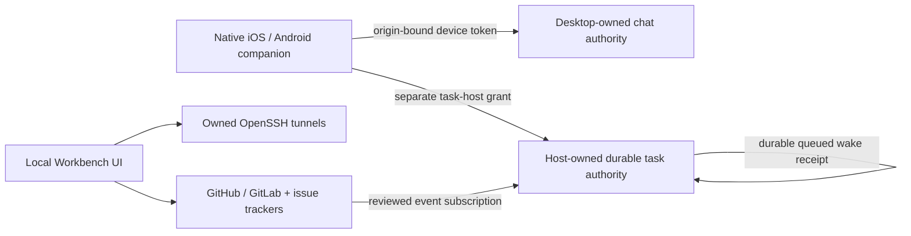

# Native mobile companion and local workflow completion

**Status:** implemented; local validation passed · **Updated:** 2026-11-13

The Workbench now executes durable tasks, but several daily workflows still end
in a terminal or another product. Finish the missing forge/tracker integrations,
SSH connection ownership, task wake subscriptions, historical usage and device
video. Add an actual iOS/Android companion for supervising the user's own host.
Managed compute, pairing relays and hosted task storage remain excluded.

## Ownership

Native desktop chats and companion-server task workspaces are separate authorities.
The existing desktop mobile API owns one-use pairing, device scopes, exact-command
receipts and native thread projections. The native phone app consumes that API;
it does not read desktop files or expose the companion's personal-data routes.
Durable task hosts use their existing isolated authenticated task listener and a
separately labelled connection kind. Tokens are bound to both origin and authority.

Use Expo/React Native for native iOS and Android interfaces and local builds.
The phone offers saved hosts, QR/manual pairing, task/thread lists, transcripts,
drafts, explicit approvals and diffs. Store native credentials in SecureStore;
never place bearer tokens in deep-link query strings, browser logs or analytics.
Reconnection refreshes current state and never replays an ambiguous mutation.
On-device speech must explicitly require local recognition and insert draft text.
No store publication or cloud build is implicit in local acceptance.

## Remaining workflows

Forge selection resolves before preview and freezes the provider and repository
identity in the execution receipt. GitLab uses its own merge/review contract.
Linear/Jira issue context uses configured HTTPS endpoints and private credentials;
browser projections never contain provider secrets. Ordinary stack merging uses
reviewed SHA leases. GitHub native asynchronous stack merging has a separate
owner-only action with a default-off acknowledgement that server-current heads
may change after preflight. Store its operation UUID and partial/unknown outcomes;
never resubmit an uncertain operation. Agent tools cannot acknowledge this action.

SSH connections own only their foreground process groups and private control
sockets. Use literal arguments, loopback forwarding, normal known-host checks
and noninteractive authentication. Restart records interruption rather than
replaying a connection or signalling an old PID. Existing user SSH sessions and
configuration are not edited. Connection/profile status is visible in Workbench.

PR wakes require a project/task-bound owner subscription. Store the source event
identity and reservation before dispatch, queue work behind a busy task, and
record uncertain crash outcomes without replay. Review text is reference data,
not additional permission to publish or merge.

Historical usage imports require explicit preview/commit. Read only provider
metadata and reported counters; never expose prompts or tool content. Dedupe
Claude message IDs and Codex cumulative counters. Imported CLI history is shown
separately from measured Bruhs turns because older Bruhs receipts lack native
session identities and cannot be safely reconciled. Partial scans and malformed
counter sections remain visible, and no missing usage becomes a zero estimate.

Device video uses real continuous capture streams, not a screenshot polling loop.
Reuse device grants and revoke/disconnect cancellation. Never persist a stream
unless the owner separately requests recording; screenshots remain the durable
evidence path. Use bounded buffers and backpressure, and report missing local
encoder/device dependencies explicitly.

## Acceptance and delivery

Use synthetic repositories, local tracker servers, an isolated SSH fixture and
fake provider transports for destructive behavior. Add real ACP negotiation and
local iOS simulator checks where the installed tools allow them. Browser checks
must cover reconnects, stale approvals, multiple hosts, slow connections, small
screens and literal hostile text. Physical-phone trust, microphone consent,
unavailable Android tooling and externally authenticated write tests must be
reported accurately, rather than called verified by fixture success.

Preserve the shared working tree and other active feature work. Format the Rust
workspace, run applicable checks, and prepare reviewable change boundaries before
publishing. Do not absorb unrelated user changes into a release commit.

See [validation results and remaining hardware checks](workbench-mobile-v2-validation.md)
and [native app setup](native-mobile-app.md).
